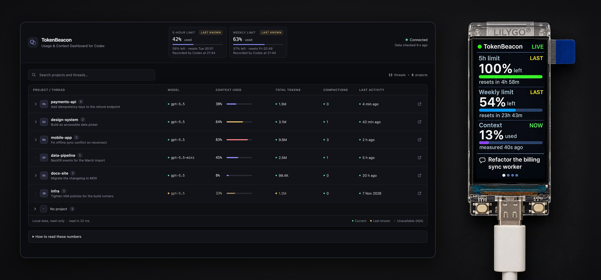
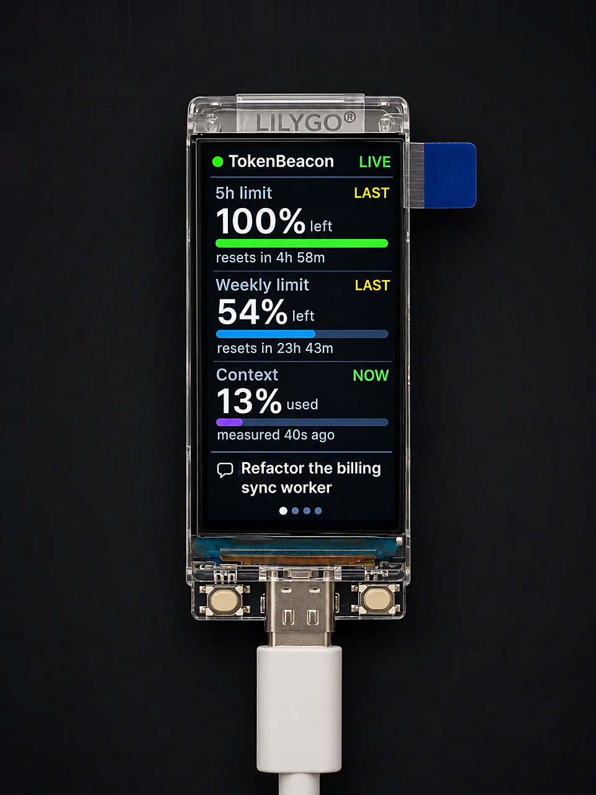
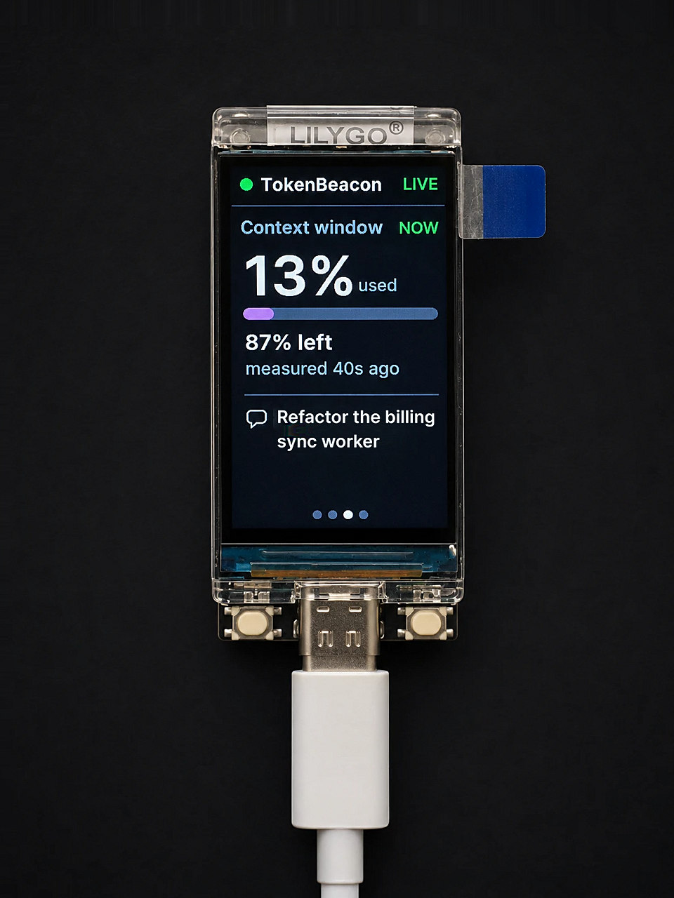
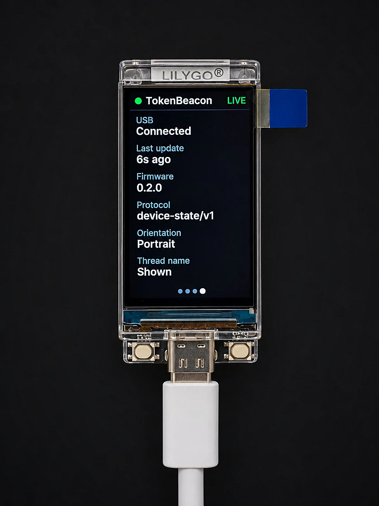
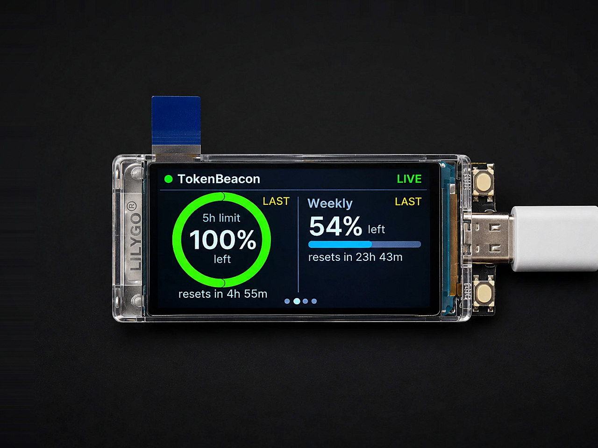

<h1 align="center">TokenBeacon</h1>

<p align="center">
  <strong>Usage &amp; Context Dashboard for Codex</strong><br>
  See how full every thread's context is, how many tokens it used and how much
  of your 5-hour and weekly limits is left – locally, read-only, on your desk.
</p>

<p align="center">
  <a href="https://github.com/msuranek/tokenbeacon/actions/workflows/ci.yml"></a>
  <a href="https://github.com/msuranek/tokenbeacon/actions/workflows/firmware.yml"></a>
  <a href="LICENSE"></a>
  
  
</p>



<p align="center"><sub>The dashboard uses fictional demo data. The display is a
photo of a real T-Display-S3; its values and thread name are illustrative.</sub></p>

> **Unofficial project.** TokenBeacon is an independent community project. It
> is not affiliated with, endorsed by, or sponsored by OpenAI. "Codex" and
> "ChatGPT" are trademarks of OpenAI.

**Status:** v0.3.0 – early and experimental. Runs on **macOS** and
**Windows 11**. The USB desk display is a preview.

## Highlights

- **Every project and thread at a glance** – context usage, token usage,
  compactions, model and last activity, read from the data Codex already
  stores on your computer.
- **Your account limits** – the 5-hour and weekly windows: used, left and when
  they reset.
- **Honest numbers** – every value is *Current*, *Last known* or *Unavailable*;
  nothing is estimated.
- **Private by design** – local only, read-only, no telemetry, no accounts, no
  credentials, no outbound connections.
- **Optional desk display (preview)** – a LILYGO T-Display-S3 on a USB cable
  shows your limits and the context of the thread you are working on.

## Quick start

```sh
git clone https://github.com/msuranek/tokenbeacon.git
cd tokenbeacon
npm install
npm start
```

Open <http://127.0.0.1:4310>. You need Node.js 22.18 or newer, Git and Codex
used at least once on this computer (details in [Requirements](#requirements)).

With a [TokenBeacon display](#desk-display-preview) plugged in:

```sh
TOKENBEACON_DEVICE=auto npm start                      # macOS
$env:TOKENBEACON_DEVICE = "auto"; npm start            # Windows PowerShell
```

## Features

- **Projects and threads** – every project with its most recent thread; expand
  a project to see the others. Threads without a project are listed separately.
- **Context window** – how full each thread's context is (used and left),
  calculated the same way Codex calculates “context left”.
- **Token usage** – input, cached input, output, reasoning and total tokens.
  The total is cumulative for the whole thread (every turn, including cached
  input), so it is often much larger than the context window.
- **Compactions** – how often Codex compacted each conversation, and when.
- **Account limits** – the 5-hour and weekly limits: percentage used and left,
  when the window resets and when Codex last recorded the values.
- **Open in Codex** – jump straight to a thread in the Codex app.
- **Honest data labels** – every value is marked *Current*, *Last known* or
  *Unavailable*. Missing values are never estimated.
- **Search** across projects and thread titles.
- **Clear diagnostics** when Codex data is missing, incomplete or in an
  unsupported format.
- **Desk display (preview)** – the limits and the current thread's context on
  a small USB display, see below.

See the [full-size dashboard screenshot](docs/screenshot.png) (fictional demo
data).

## Desk display (preview)

TokenBeacon can drive a small display next to your keyboard: a **LILYGO
T-Display-S3** (ESP32-S3 with a 1.9" 170 × 320 screen) running the
[TokenBeacon firmware](firmware/README.md). It shows your 5-hour and weekly
limits and the context of the most recently active thread, updated live over a
single USB-C cable.

<table>
  <tr>
    <td align="center" width="33%"><br><sub><b>Overview</b> – all three values</sub></td>
    <td align="center" width="33%"><br><sub><b>Context</b> – the current thread</sub></td>
    <td align="center" width="33%"><br><sub><b>Info</b> – connection and settings</sub></td>
  </tr>
  <tr>
    <td align="center" colspan="3"><br><sub><b>Limits</b> in landscape – the 5-hour ring and the weekly limit with reset times</sub></td>
  </tr>
</table>

<sub>Photos of a real T-Display-S3 running TokenBeacon, retouched for
consistent framing and background. The thread name and the values are
illustrative; on the Limits photo the screen indicator was corrected to match
the firmware.</sub>

### Four screens

Dots at the bottom of the display show which screen is open.

| Screen | What it shows |
| --- | --- |
| **Overview** | 5-hour limit, weekly limit and context in one view, with reset times, measurement age and (optionally) the thread name. |
| **Limits** | The 5-hour limit as a ring and the weekly limit, each with its reset countdown. |
| **Context** | Context used and left for the most recently active thread, when it was measured and (optionally) its name. |
| **Info** | USB connection, last update, firmware version, protocol, orientation and whether the thread name is shown. |

Each value carries a tag: `NOW` (current, link live), `LAST` (last known),
`WAIT` (the limit window has ended and no new value exists yet) or `N/A`
(TokenBeacon has no value). The status in the top right is `LIVE`, `STALE` (no
update for over 30 seconds) or `OFFLINE` (over 2 minutes).

### Button, portrait and landscape

Of the two buttons next to the USB-C port, **BOOT** is left alone; the other
one (**GPIO14**) controls the display:

- **Short press** – next screen: Overview → Limits → Context → Info.
- **Hold for about a second** – switch between **portrait** (USB-C at the
  bottom) and **landscape** (USB-C on the right). The display remembers the
  orientation and starts on Overview.

### USB connection

- One USB-C cable carries power and data; the display has **no Wi-Fi, no
  Bluetooth and no network**, and the firmware never starts them.
- With `TOKENBEACON_DEVICE=auto`, TokenBeacon looks for a USB device named
  **TokenBeacon Display**, checks it with a handshake and only then sends data.
  Other serial devices are left alone. You can also name a port, for example
  `COM5` or `/dev/cu.usbmodem1101`.
- TokenBeacon sends only the limits, the context, whether each value is
  current and how old it is. It never sends project names, prompts,
  conversation content, file paths, token counts, model names or credentials
  ([protocol](docs/device-protocol.md)). The display stores only its
  orientation.
- Unplug the display at any time: TokenBeacon releases the port and reconnects
  when it is back. If another program holds the port, TokenBeacon waits and
  retries; it never stops other programs, and it never resets the board.
- `/api/health` shows the display's state (`searching`, `handshake`,
  `connected`, `busy`, `unrecognized`) with a short code.

### Thread name (optional)

With `TOKENBEACON_DEVICE_TITLE=on`, TokenBeacon also sends the name of the
thread whose context is shown – exactly as the dashboard shows it. The display
shows it on Overview and Context while the data is live, wraps it to the
available width (`...` when cut) and never stores it. It is **off by default**:
a thread name can contain anything you typed, so leave it off if others can
see the display.

```sh
TOKENBEACON_DEVICE=auto TOKENBEACON_DEVICE_TITLE=on npm start
```

```powershell
$env:TOKENBEACON_DEVICE = "auto"; $env:TOKENBEACON_DEVICE_TITLE = "on"; npm start
```

### Set up the display

1. Get a **LILYGO T-Display-S3** (the non-touch version is enough) and a USB-C
   data cable.
2. Install [PlatformIO Core](https://platformio.org/) and flash the firmware
   from source – see [firmware/README.md](firmware/README.md):
   ```sh
   cd firmware
   pio run -e tdisplay_s3 -t upload
   ```
3. Start TokenBeacon with `TOKENBEACON_DEVICE=auto` (see above). The display
   shows “Waiting for TokenBeacon” until it connects, then `LIVE`.

Enable the display in **one** TokenBeacon instance only: two instances on the
same display interfere with each other.

## Privacy and security

TokenBeacon is built to be privacy-first and strictly read-only.

- **Local only.** The server listens on `127.0.0.1` and cannot be reached from
  your network. It makes no outbound connections: no telemetry, no analytics,
  no accounts, no cloud services.
- **Read-only.** Codex databases are opened read-only with SQLite's
  `query_only` mode enforced and verified. Nothing is ever written to the Codex
  data folder; caches live in memory only.
- **No credentials.** `auth.json` and other credential files are never read.
- **No inference.** The monitor never sends requests to OpenAI, never starts a
  Codex App Server and never runs a model to obtain numbers.
- **Minimal data in the browser.** The dashboard receives project names,
  thread titles, thread IDs and metrics. File paths and working directories are
  never sent to the browser.
- **Protected local API.** Requests with a foreign `Host` or `Origin` are
  rejected (DNS rebinding protection), no CORS access is granted, and every
  response carries a strict Content Security Policy.

### What it reads

From your Codex data folder (`CODEX_HOME`, default `~/.codex` on macOS and
`%USERPROFILE%\.codex` on Windows):

| File | Used for |
| --- | --- |
| `state_5.sqlite` | projects, project folders, threads |
| `thread_history_1.sqlite` | context compaction history |
| `sqlite/codex.db` | the Codex app's thread list (which threads are visible) |
| `sessions/**/rollout-*.jsonl[.zst]`, `archived_sessions/**/…` | model, token, context and limit data |

Session logs are only read if their real location (after resolving symlinks
and, on Windows, junctions and `\\?\` path prefixes) is inside `sessions/` or
`archived_sessions/`. Compressed logs are unpacked in
memory with Node.js's built-in zstd support, with a size limit per file.

## Requirements

- **macOS or Windows 11.**
  - macOS: tested on macOS 26 with Apple silicon. Intel Macs are expected to
    work but are untested.
  - Windows: tested on Windows 11 with the Codex desktop app. Use PowerShell
    or Command Prompt.
  - Linux and WSL are not supported.
- **Node.js 22.18 or newer**, ideally the current LTS release. The app uses the
  built-in `node:sqlite` module and runs TypeScript directly. CI tests
  Node.js 24 on macOS and Windows.
  - macOS: [nodejs.org](https://nodejs.org/) or Homebrew: `brew install node`.
  - Windows: [nodejs.org](https://nodejs.org/) or
    `winget install OpenJS.NodeJS.LTS`.
- **Git.**
  - macOS: for example the Xcode Command Line Tools: `xcode-select --install`.
  - Windows: [git-scm.com](https://git-scm.com/) or `winget install Git.Git`.
- **Codex** (the desktop app or the CLI) used at least once on this computer.

No other tools are needed: compressed session logs are read with Node.js's
built-in zstd support.

Check your setup on macOS:

```sh
node --version   # v22.18.0 or newer
ls ~/.codex      # Codex data folder (or your CODEX_HOME)
```

On Windows (PowerShell):

```powershell
node --version                          # v22.18.0 or newer
Test-Path "$env:USERPROFILE\.codex"     # True (or check your CODEX_HOME)
```

## Installation

The same commands work in the macOS Terminal and in Windows PowerShell or
Command Prompt:

```sh
git clone https://github.com/msuranek/tokenbeacon.git
cd tokenbeacon
npm install
npm start
```

Then open <http://127.0.0.1:4310>.

- The first `npm start` builds the dashboard automatically.
- The server is available immediately; reading your Codex data can take a few
  seconds on the first start, while the dashboard shows a loading state.
- Stop the server with `Ctrl+C`.

To update, run `git pull`, then `npm install` and `npm start`. The dashboard is
rebuilt automatically when its sources change.

`npm ci` installs exactly the versions in `package-lock.json`. All npm
packages are build tools; the server itself uses only Node.js built-ins.

## Configuration

| Variable | Default | Description |
| --- | --- | --- |
| `CODEX_HOME` | `~/.codex` (macOS), `%USERPROFILE%\.codex` (Windows) | Location of your Codex data folder. Codex uses this folder unless you set `CODEX_HOME` for it; use the same value here. |
| `TOKENBEACON_PORT` | `4310` | Local port for the dashboard. |
| `TOKENBEACON_DEVICE` | `off` | Optional USB display (preview, see [firmware/](firmware/README.md)): `auto` finds a connected TokenBeacon display, or name one port, e.g. `COM5` or `/dev/cu.usbmodem1101`. See [the protocol](docs/device-protocol.md). |
| `TOKENBEACON_DEVICE_TITLE` | `off` | `on` also shows the name of the most recent thread (the one whose context is shown) on displays that support it. The name is shown as on the dashboard and can contain anything you typed; leave it off if others can see the display. |

macOS (Terminal):

```sh
CODEX_HOME=/path/to/codex-data npm start
TOKENBEACON_PORT=4311 npm start
```

Windows PowerShell (the variable stays set for that PowerShell window):

```powershell
$env:CODEX_HOME = "D:\path\to\codex-data"; npm start
$env:TOKENBEACON_PORT = "4311"; npm start
```

Windows Command Prompt:

```bat
set "CODEX_HOME=D:\path\to\codex-data" && npm start
set "TOKENBEACON_PORT=4311" && npm start
```

When TokenBeacon cannot start, its message shows the matching command for your
system.

The server always binds to `127.0.0.1`. This is intentional and not
configurable: the dashboard has no login, so it must not be exposed to a
network.

## Reading the dashboard

- **Current** values were just read from an active session or the local
  database, and Codex has recorded nothing since that could change them.
  **Last known** values are the latest ones Codex recorded and may be out of
  date – for example a thread's context after a new turn started, its settings
  or model changed, or it was compacted, until Codex measures it again.
  **Unavailable (N/A)** means Codex didn't record the value or it couldn't be
  read.
- **Context used** is how full a thread's context window is; context left is
  the rest (58% used = 42% left). The bar turns amber at 60% and red at 80%.
- **Account limits** show how much of each usage window is used. Codex records
  limits only while you use it, so they are always *last known*. When a window
  has ended and no newer data exists, the card shows **Awaiting fresh data**
  instead of the old percentage. It updates after your next Codex request.
- **Last activity** is when Codex last worked in the thread: a turn, messages,
  reasoning, tool calls or compaction. Merely opening a thread or changing its
  settings does not count, so it does not move the thread to the top or onto
  an external display.
- **Data checked** (top right) is when TokenBeacon last read the local Codex
  data; it checks every 5 seconds. **Recorded by Codex** on the limit cards is
  when Codex itself saved the limits, which can be much earlier.
- **Project assignment.** Most threads are linked to a project by Codex. If a
  thread has no link, the monitor matches its working folder to a project
  folder; such matches are shown as *Matched by folder (estimate)* in the
  thread details.

The dashboard includes a short “How to read these numbers” section below the
table.

## Known limitations

- **Unofficial data formats.** TokenBeacon reads Codex's internal local
  storage, which is not a public API and can change with any Codex update. The
  monitor detects the schema and degrades gracefully (missing values become
  *Unavailable*), but new Codex versions may need updates.
- **Limits are only as fresh as the last local Codex request.** Usage from
  other devices, the web or cloud tasks is not visible until Codex on this
  computer records new limit data.
- **Project assignment by folder is an estimate** and can be wrong for nested
  or moved folders.
- **Thread visibility** follows the Codex app's thread list. If that list is
  unavailable, an estimate is used and the dashboard says so.
- **Open in Codex** needs the Codex desktop app; it opens `codex://` links.
- **Large histories:** the first start can take several seconds while archived
  threads are decompressed. The dashboard refreshes every 5 seconds.
- **Single user, local machine.** There is no authentication. Do not put the
  monitor behind a reverse proxy or expose it to a network.
- **Desk display is a preview.** It is verified on a LILYGO T-Display-S3 with
  macOS and Windows 11, and the firmware is built and flashed from source.
  Only one TokenBeacon instance per computer should have the display enabled.

## Troubleshooting

| Problem | What to do |
| --- | --- |
| “Codex data not found” | Open Codex once, or set `CODEX_HOME` to your Codex data folder. |
| “Port 4310 is already in use” | TokenBeacon may already be running: open <http://127.0.0.1:4310>. Otherwise use another port, e.g. `TOKENBEACON_PORT=4311 npm start` (macOS) or `$env:TOKENBEACON_PORT = "4311"; npm start` (PowerShell). |
| “TokenBeacon cannot run on this Node.js runtime” | Install Node.js 22.18 or newer (LTS recommended). Check with `node --version`. |
| `command not found: npm` (macOS) or “npm is not recognized” (Windows) | Node.js is not installed or not on your `PATH`. Install it (see Requirements), then open a new Terminal or PowerShell window. |
| PowerShell: “running scripts is disabled on this system” when running `npm` | Your PowerShell execution policy blocks `npm.ps1`. Run `npm.cmd install` and `npm.cmd start` instead, or use Command Prompt. |
| “Open in Codex” does nothing | Install and open the Codex desktop app once so the system registers `codex://` links. |
| Many values show N/A | Your Codex version may store data differently. The notice above the table explains which data is missing. |
| A limit shows “Awaiting fresh data” | The usage window has ended. Make any request in Codex; the card updates automatically. |
| “The local server isn't running” | Start it with `npm start`; the page reconnects automatically. |
| The display shows “Waiting for TokenBeacon” | Start TokenBeacon with `TOKENBEACON_DEVICE=auto` and check the `device` entry in `/api/health`. Use a USB-C cable that carries data, not only power. |
| `/api/health` shows the display as `busy` | Another program (for example a serial monitor) has the port open. Close it; TokenBeacon retries on its own. |
| The display shows `STALE` or `OFFLINE` | TokenBeacon stopped sending: check that it is still running and that only one instance has the display enabled. |

For a technical overview of each data source, open
<http://127.0.0.1:4310/api/health>. It lists every source with a short status
code and never contains file paths or conversation content, so it is safe to
include in a bug report.

## Development

```sh
npm run dev        # Vite dev server on http://127.0.0.1:5173 (run npm start as the API backend)
npm test           # functional and security tests with synthetic data only
npm run check      # typecheck + tests + production build
npm run test:live  # optional smoke test against your own Codex data (read-only)
npm run bench      # optional refresh benchmark against your own Codex data
```

To try the dashboard without your own data, create a fictional Codex folder:

```sh
node scripts/create-demo-data.ts /tmp/codex-demo
CODEX_HOME=/tmp/codex-demo npm start
```

`npm test` never reads your real Codex data: it builds temporary Codex folders
with synthetic data. See [CONTRIBUTING.md](CONTRIBUTING.md).

Project layout:

```text
src/main.mjs            entry point: runtime check, dashboard build, start
src/start.ts            starts the HTTP server and background refresh
src/http-server.ts      local API and static files, request validation
src/snapshot-service.ts builds the normalized snapshot
src/limits.ts           account limit selection and window expiry
src/sources/            read-only SQLite and rollout readers
src/client/             React dashboard
tests/                  automated tests (synthetic fixtures)
scripts/                development tools (fictional demo data)
.github/workflows/      CI on macOS and Windows
```

## Security

Please report vulnerabilities privately; see [SECURITY.md](SECURITY.md).

## License

[MIT](LICENSE)
