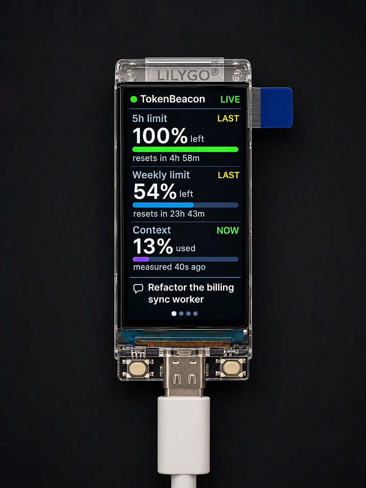

# TokenBeacon display firmware (preview)

Firmware for an optional desk display that shows TokenBeacon's 5-hour limit,
weekly limit, the context of the most recent Codex thread and, optionally, that
thread's name. It talks to
TokenBeacon over a single USB-C cable using the
[`device-state/v1`](../docs/device-protocol.md) protocol.

> **Preview.** Verified on a T-Display-S3 with macOS and Windows 11.

<p align="center"></p>

<p align="center"><sub>Photo of a real board; the values and the thread name are
illustrative. More screens in the <a href="../README.md#desk-display-preview">main README</a>.</sub></p>

- Reference board: **LILYGO T-Display-S3** (ESP32-S3, 16 MB flash, 8 MB PSRAM,
  1.9" ST7789 170 × 320 display). The touch version is not needed.
- No Wi-Fi, no Bluetooth, no network: the firmware never starts them.
- Shows only what TokenBeacon sends; missing values are shown as `N/A`.
- Stores only the screen orientation (NVS); never any data from TokenBeacon.

## Build and test

Requires [PlatformIO Core](https://platformio.org/) 6.1.18 (or the PlatformIO
extension for VS Code). Versions are pinned in `platformio.ini`:
`espressif32@6.5.0` (Arduino-ESP32 2.0.14), TFT_eSPI 2.5.43 and
ArduinoJson 7.4.2. Newer Arduino-ESP32 versions are not supported by this
TFT_eSPI setup.

```sh
cd firmware
pio test -e native      # protocol, model and formatting tests on your computer
pio run -e tdisplay_s3  # build the firmware
```

The host tests use the same protocol vectors as TokenBeacon
(`tests/device-vectors`), so both sides follow the same rules.

## Flash

```sh
pio run -e tdisplay_s3 -t upload
```

The firmware uses the ESP32-S3's own USB (TinyUSB) and reports itself as
**TokenBeacon Display**. If the upload does not start, put the board into
download mode: hold **BOOT**, press and release **RST**, release **BOOT**, then
upload again and press **RST** afterwards.

## Use with TokenBeacon

```sh
TOKENBEACON_DEVICE=auto npm start                      # macOS
$env:TOKENBEACON_DEVICE = "auto"; npm start            # Windows PowerShell
```

The display shows “Waiting for TokenBeacon” until TokenBeacon connects.

**Button** (GPIO14, the one that is not BOOT):

- short press: next screen – **Overview** (all three values), **Limits** (5-hour
  ring and weekly limit with reset times), **Context** (usage, what is left, when
  it was measured), **Info** (connection, last update, firmware, protocol,
  orientation, whether the thread name is shown); dots at the bottom show which one is open;
- hold for about a second: switch between portrait and landscape. The display
  remembers the orientation and starts on Overview.

**Thread name.** With `TOKENBEACON_DEVICE_TITLE=on` TokenBeacon also sends the
name of the thread whose context is shown, as the dashboard shows it. The display
shows it on Overview and Context, cut to the available width with `...`, only
while the data is live (it disappears when the data is stale or offline, when
TokenBeacon disconnects or turns it off) and never stores it. Characters the
display font lacks (for example emoji) appear as `?`.

**Labels.** `NOW` marks a value TokenBeacon reported as current while the link
is live, `LAST` an older one; `WAIT` means the limit window has ended and no new
value exists yet; `N/A` means TokenBeacon has no value. The status in the top
right is `LIVE`, `STALE` (no update for over 30 s) or `OFFLINE` (over 2 min).

## Layout

| Path | Contents |
| --- | --- |
| `lib/tb_core/` | Portable protocol parser, display model, UTF-8 text layout, button and formatting (host-tested) |
| `src/main.cpp` | USB identity, protocol loop, button and stored orientation |
| `src/ui.cpp` | The four screens in portrait (170 × 320) and landscape (320 × 170) |
| `src/fonts/` | Inter (SIL OFL 1.1) as anti-aliased display fonts, incl. Czech characters |
| `tools/make_vlw.swift` | Generates the display fonts (macOS) |
| `test/test_core/` | Unity tests with the shared vectors |
| `boards/` | Board definition for PlatformIO |
